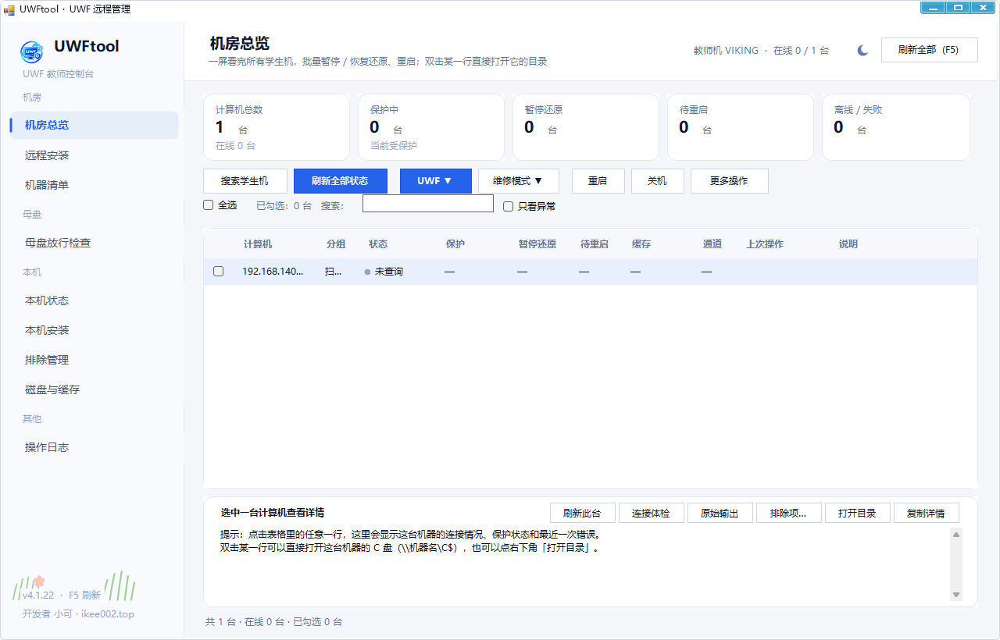
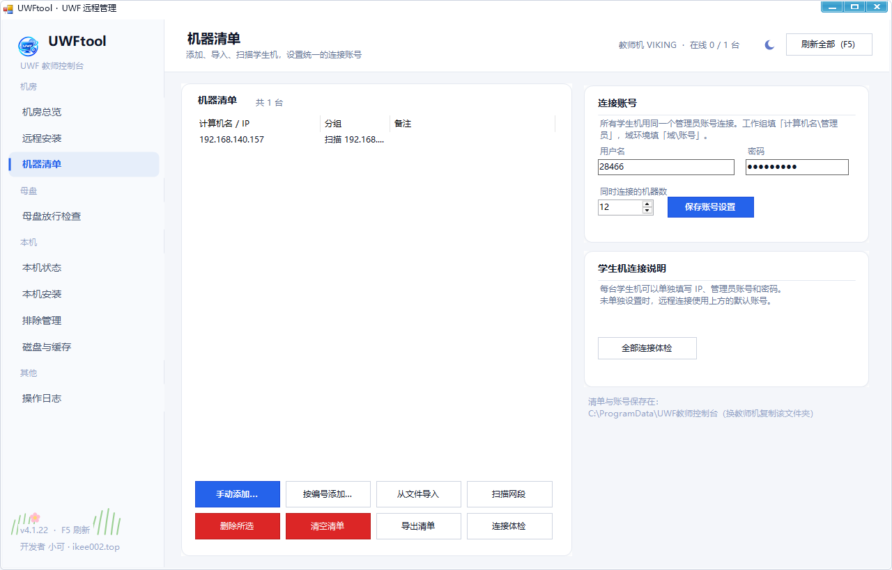
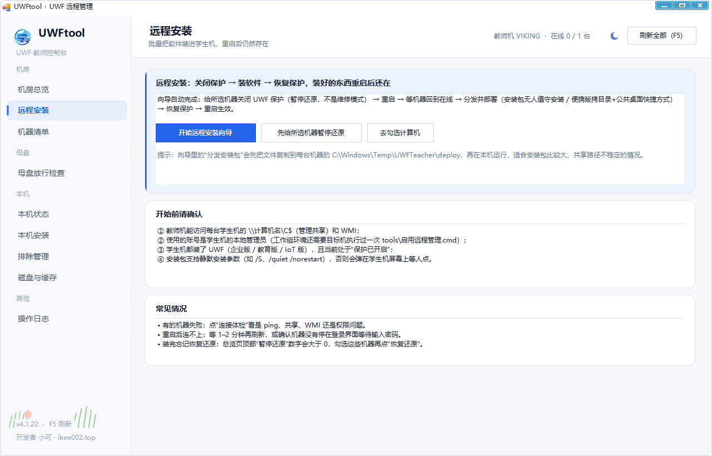
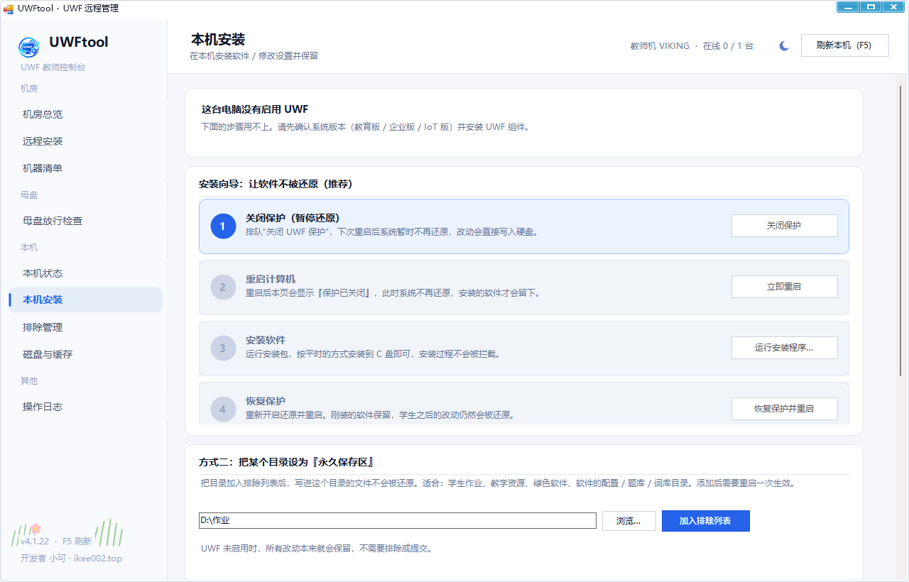

# UWF 教师控制台 · 机房远程版

> 在教师机上一个窗口里，管理 50 台学生机的 **UWF（统一写入筛选器）**：
> 看状态、批量暂停/恢复还原、批量重启、**远程安装软件并且重启后不被还原**。
>
> 开发者：**小可** ｜ 网站：<https://www.ikee002.top>



---

## 0. 一分钟流程

| 步骤 | 在哪做 | 做什么 |
| --- | --- | --- |
| ① 准备 | 每台**学生机** | 以管理员身份运行一次 `tools\启用远程管理.cmd`，然后重启 |
| ② 建档 | 教师机 →「机器清单」填账号 →「机房总览」 | 点「搜索学生机」自动发现并加入清单；也可按编号批量添加 `PC-01…PC-50` |
| ③ 看状态 | 教师机 →「机房总览」 | 点「刷新全部状态」，50 台一屏看完 |
| ④ 装软件 | 教师机 →「远程安装」 | 勾选机器 → 向导：暂停还原 → 重启 → 等待上线 → 分发安装 → 恢复还原 |

接下来是每一部分的细节。

---

## 1. 它是怎么工作的（为什么不用装客户端）

教师机不往学生机装任何常驻程序，而是走 Windows 自带的远程管理通道：

- **状态读取**：优先用 WMI 直接读学生机上的 `root\standardcimv2\embedded`（UWF 的官方接口），一次拿到保护状态、维护状态、缓存用量、受保护卷。
- **执行操作**：在学生机的 `C:\Windows\Temp\UWFTeacher\` 写一个临时脚本 → 远程启动 → 读回结果 → 删除。所以本质上还是调用学生机自己的 `uwfmgr.exe`，和在本机点按钮完全一样。
- **两条通道**：
  - `WMI`（快，首选，几百毫秒一台）
  - `SMB`（备用，需要能访问 `\\计算机名\C$`，一两秒一台）
  表格里的「通道」列会显示每台机器实际用的是哪条；两条都不通就是「失败」，看「说明」列。

> 50 台默认 12 台并发，刷新一轮大约 15–30 秒（取决于有多少台离线）。
> 并发数可以在「机器清单 → 连接账号」里调整。

---

## 2. 学生机准备（每台一次）

### 2.1 系统要求

| 项目 | 要求 |
| --- | --- |
| 系统 | Windows 10 / 11 **企业版、教育版、IoT 企业版**（家庭版、专业版没有 UWF） |
| 组件 | 已启用 UWF（`C:\Windows\System32\uwfmgr.exe` 存在） |
| 网络 | 与教师机同一网段，能互相访问 |
| 账号 | 有一个**本地管理员**（或域管理员）账号供教师机使用 |

### 2.2 运行准备脚本

把 `tools\启用远程管理.cmd` 复制到每台学生机，**右键 → 以管理员身份运行**，然后重启。

它只做四件事，都是 Windows 自带功能：

1. 打开「文件和打印机共享」的防火墙规则，并确保 `LanmanServer` 服务自启；
2. 打开 WMI 的防火墙规则，确保 `Winmgmt` 服务自启；
3. 写入 `LocalAccountTokenFilterPolicy=1`（**工作组环境必需**：否则本地管理员账号远程访问 `C$` 会被 UAC 过滤掉）；
4. 允许 ping，方便教师机判断机器是否在线。

脚本会打印本机计算机名和 IP，可以记下来核对清单。

### 2.3 验证

教师机 →「机器清单」→ 选中一台 →「连接体检」，理想结果是四个 ✔：

```
✔ 网络可达（ping）：通
✔ 管理共享 \\PC-01\C$：可访问
✔ WMI 连接：正常
✔ 状态读取：成功，通道 WMI
```

如果第 2、3 项是 ✘，回到 2.2 检查脚本是否执行、是否重启、账号是否管理员。

> 不能批量运行脚本时，可以在每台机器上手动执行脚本里的四条 `netsh` / `reg` 命令（内容见脚本，网管一看就懂）。

---

## 3. 教师机第一次配置：先填账号，再「搜索学生机」

1. 双击 `UWFtool.exe`，UAC 点「是」。
2. 先到「机器清单 → 连接账号」填**学生机的管理员账号**：
   - 工作组：`学生机名\管理员账号`（例如 `PC-01\admin`），各机器账号密码一致时最省事；
   - 域：`域\账号`；
   - 点「保存账号设置」。密码用 Windows DPAPI 加密存在本机，只有当前 Windows 账号能解密。

   > 搜索和后续所有操作都用这个账号；账号没填就搜索，会出现"能 ping 通但读不到状态"。

3. 回到「机房总览」，点左上角 **「搜索学生机」**：

   

   - 程序会自动读出教师机所在的网段（自动忽略 VMware / Hyper-V / VPN 等虚拟网卡），也可以手动填写；
   - 支持 `192.168.1.`、`192.168.1.10-60`、`192.168.1.0/24`，一行一个，右下角会实时显示要扫描多少个地址；
   - **探活不只看 ping**：先 ICMP，再探 445 / 135 / 139 / 3389 端口，最后用 ARP 兜底——禁 ping 的机器也能被发现；
   - 再用 WMI 逐台确认是否真的装了 UWF；结果会区分「不是 UWF 机器」和「连上但读不到（账号 / 权限问题）」；
   - 默认自动勾选 UWF 机器，也可以手动勾选；点「加入机器清单」完成建档，并自动刷新状态。

4. 也可以在「机器清单」里手工维护：
   - **按编号批量添加**：前缀 `PC-`、起始 `1`、结束 `50`、位数 `2` → `PC-01…PC-50`；
   - 「从文件导入」，CSV 每行 `计算机名,分组,备注`；
   - 「扫描网段」按 IP 段扫描（只按 ping 发现，不识别 UWF）。
5. 并发数保持 12 即可；50 台以上可以调到 16–20（太多会被学生机防火墙限流）。


---

## 4. 日常使用：机房总览


### 4.1 看

顶部五个数字：**总数 / 保护中 / 暂停还原 / 待重启 / 离线失败**。
"暂停还原"大于 0 就说明有机器还没恢复还原——这是最容易忘的一步。

表格每行一台机器：

| 列 | 含义 |
| --- | --- |
| 状态 | 正常 / 待重启 / 暂停还原 / 维修模式 / 未保护磁盘 / 无 UWF / 无法连接（左侧小圆点同色） |
| 保护 | 已开启 / 已排队 / 已暂停 / 未保护磁盘 / 不支持 |
| 暂停还原 | 是 = 现在不还原（装软件的状态） |
| 待重启 | 是 = 有设置排队，重启才生效 |

> **双击某一行 → 直接在资源管理器打开这台机器的 C 盘**（`\\计算机名\C$`），会用「机器清单」里保存的账号先认证一次，
> 不会再单独弹“输入网络密码”；连不上会提示具体原因（共享没开 / 防火墙 / 账号不是管理员）。
> 右键菜单里也有「打开目录」，详情区右下角的「打开目录」按钮作用相同。
>
> **离线（无法连接）的机器不能操作**：双击不会打开目录，会直接提示先确认开机 / 网络；
> 批量暂停、恢复、重启、加排除、执行命令、设置缓存、远程安装都会自动跳过离线机器并列出跳过了哪几台。
> 「刷新」和「连接体检」仍然可用——这两个本来就是用来查它为什么离线的。
| 缓存 | 当前缓存占用（MB） |
| 通道 | 这台机器走 WMI 还是 SMB；两条都不通显示「—」 |
| 上次操作 | 最近一次批量动作 |
| 说明 | 失败原因（自动翻译成可操作的建议）或状态提示 |

> 「无法连接」和「无 UWF」是两回事：前者是网络 / 账号 / 防火墙问题，后者说明机器在线但没有 UWF 组件。以前这两种都会显示成「读取失败」，现在分开判断。

勾选框用于批量操作；「全选」勾当前显示的机器；「只看异常」过滤失败项；搜索框按名字/分组过滤。
点某一行，下方显示这台机器的详情；点「排除项…」可以看它当前的文件 / 注册表排除列表。

### 4.2 批量操作

先勾选机器，再点：

| 按钮 | 作用 | 生效方式 |
| --- | --- | --- |
| 暂停还原 | 关闭 UWF 保护（`filter disable`） | **重启后生效** |
| 恢复还原 | 重新开启保护（`filter enable`） | **重启后生效** |
| 重启 / 关机 | 立即执行 | 立即 |
| 更多 → 批量添加/删除目录排除 | 给学生机加 `D:\作业` 之类的排除 | 重启后生效 |
| 更多 → 批量设置缓存上限 | 统一改缓存大小（MB） | 重启后生效 |
| 更多 → 在目标机执行命令 | 跑一条命令，例如 `\\教师机\软件\setup.exe /S` | 立即 |
| 更多 → 导出结果为 CSV | 交报告 / 存档 | — |

每个动作都会逐台回读状态并写进表格，失败原因留在「说明」列。

---

## 5. 远程安装软件（向导）



入口：「远程安装」页 →「开始远程安装向导」，或「机房总览 → 更多 → 远程安装向导」。

**第 1 步 关闭 UWF 保护（暂停还原）**：给勾选的机器排队 `filter disable`。
**第 2 步 重启所选**：让关闭保护生效。机器会离线 1–2 分钟。
**第 3 步 等待到在线**：点「重新检测」，直到全部显示在线，并且日志里每台都写着「UWF 保护已关闭」。只要有机器提示「仍在保护」，就说明重启没有真正发生（比如有程序阻止重启），此时**不要安装**——安装内容会全部写进 UWF 缓存，缓存写满后机器重启会黑屏。
（第 4 步在每台安装前还会再确认一次保护是否真的关闭，没生效的机器会被主动跳过。）
**第 4 步 分发并部署**（支持两种软件，以及两种文件来源）：

*安装包（exe / msi / bat）*：

- **不用填参数**：勾「**静默安装**」即可，程序会先识别安装包类型再给参数（Inno Setup → `/VERYSILENT /SUPPRESSMSGBOXES /NORESTART`，NSIS → `/S`，MSI → `/quiet /norestart`，InstallShield → `/s /v/qn`）；识别不准可在「附加参数」里改；不勾则按正常方式装、可能弹安装界面；
- 「从教师机分发」：先把安装包复制到每台机器的 `C:\Windows\Temp\UWFTeacher\deploy\`，再在本机路径运行（比走共享路径稳）；
- 「文件已在学生机」：直接填学生机上的完整路径（适合先用电子教室把文件传过去的工作流），远程拉起安装；
- 勾「等待安装完成」会等安装进程退出（适合静默安装）；不勾则只负责拉起安装程序（适合需要点下一步的安装向导，会弹在学生机屏幕上）。

> **第 4 步现在全程能看到进度，装不上也查得出原因**（2026-11 起）：
> - 复制阶段显示 `312.4 MB / 698.1 MB（45%），12.4 MB/s，约剩 31 秒`，不再只有一个不动的 `0 / 1 台`；
> - 复制完成、启动安装、安装耗时（`已用 3 分 12 秒`）都会写进下方日志，卡住时一眼能看出卡在**复制**还是**安装**；
> - **安装包的输出和退出码会回传到日志**：以前“已启动”之后就没有任何信息，装没装上全靠猜；现在会打出
>   `安装包正常退出（退出码 0，用时 1 分 40 秒）` 或 `安装包返回非 0 退出码 1：…`，安装包自己打印的每一行也进日志；
> - 运行前会先 `cd` 到安装包所在目录再启动（有些安装包靠相对路径找附属文件，工作目录不对会直接没反应）；
> - 复制超过 3 分钟毫无进展会直接判为失败；复制完会核对目标机文件大小；
> - 「同时台数」（默认 4，最多 8）控制一次处理几台：50 台装同一包时建议 4–6 台；
> - 勾「**以登录用户运行**」→ 安装程序跑在**登录学生的会话里**，安装界面会出现在学生机屏幕上（适合要点下一步的包）；
>   不勾则在系统会话里静默跑（适合 `/S`、`/quiet` 这类静默参数）。注意：以登录用户身份需要那台机器有人登录着；
> - 安装包放在映射盘上会提示“经教师机中转，速度取决于两端”。
>
> **目标计算机列表来自机房总览里勾选的机器**：要装 50 台就先在总览勾选 / 全选（「更多操作 → 全选（当前显示）」），
> 再打开本向导；向导里的「全选」只作用于这个列表。

*便携版（绿色软件目录）*：

- 「从教师机分发」：整个目录递归复制到学生机的 `C:\Program Files\<目录名>\`；
- 「文件已在学生机」：直接用学生机上已有的目录（电子教室传好即可）；
- 自动在**公共桌面**（`C:\Users\Public\Desktop`）创建启动快捷方式，所有学生账号都能看到；快捷方式在教师机本地生成再复制过去，不往学生机写脚本。

**第 5 步 恢复还原（重新开启 UWF 保护）**：排队 `filter enable`。
**第 6 步 重启生效**：重启后恢复还原、软件保留，系统回到全盘保护状态。

> 装完一定要做第 5、6 步。做完回到总览刷新一次，确认「保护中」数量回到 50、「暂停还原」变成 0。

> **向导用的不是「维修模式」。** 它只是把 UWF 保护暂时关掉（`filter disable`），随时可以恢复；
> 「维修模式」（`servicing enable`）是微软留给 Windows 更新的独立模式，进入/退出都会自己重启，
> 更新没装完就退出会黑屏。装软件请始终用本向导或「UWF ▼ → 关闭 UWF」，不要用「维修模式 ▼」。

### 装完怎么确认真的保留了

1. 向导第 5 步（恢复还原）+ 第 6 步（重启生效）执行完；
2. 总览刷新：该机器「保护」= 已开启、「暂停还原」= 否；
3. 随便找一台学生机，让学生建个文件 → 重启 → 文件消失（说明还原正常），而刚装的软件还在（说明安装成功）。

---

## 6. 常见问题

**Q0：搜索学生机一台都找不到。**
先确认教师机和学生机在同一网段（`ipconfig` 看一下）。搜索已经不只靠 ping：禁 ICMP 的机器会用 445/135 端口和 ARP 发现。仍然找不到时：
① 检查是否填成了别的网段（支持 `192.168.1.10-60`、`192.168.1.0/24`）；
② 学生机和教师机之间是否有 VLAN / 三层隔离（ARP 和端口探测都过不去时，请用「按编号批量添加」）；
③ 教师机是否开了第三方防火墙拦截出站探测。\n**Q1：50 台全部失败。**
先检查教师机用的账号：是不是学生机的管理员？工作组环境是否执行过准备脚本并重启？再看「连接体检」的第 2、3 项。

**Q2：一部分成功、一部分失败。**
选中失败的那几台 →「连接体检」。常见原因：机器没开机 / 停在登录界面 / 防火墙策略不同 / 个别机器没跑准备脚本。

**Q3：刷新很慢。**
离线机器要等超时（每台约 8–10 秒）。可以把并发数调大，或先用「只看异常」筛出来单独处理。

**Q4：重启后一直连不上。**
学生机可能停在登录界面等输入密码，或者网络还没就绪。等 1–2 分钟再点「重新检测」；仍不行就到那台机器上看一眼。

**Q5：在桌面建了文件夹 / 改了设置，重启却没有还原。**\n先看"本机状态"的「保护卷」：如果是「无」，说明只是打开了 UWF 过滤器，**没有任何磁盘在保护列表里**——写入直接落盘，当然不还原。到「磁盘与缓存」勾选 C 盘 → 应用 → 重启即可（新版会直接弹红色警告并给出一键「保护 C 盘」）。\n如果保护卷正常，再检查：① 桌面/文档是不是被重定向到了 D 盘或 OneDrive（那个位置不受保护）；② 是否开启了「持久缓存」；③ 改动是不是在开启保护之前就存在的（旧文件不会被还原）。\n\n**Q5b：软件装完重启又没了。**
说明安装时系统还在保护状态：要么第 1 步没执行，要么执行了没重启（看「待重启」列）。按向导重新走一遍。
（注意：只在第 1 步“排队”而没有重启，系统仍然在还原——必须看到「UWF 保护已关闭」才算生效。）

**Q5c：装完重启黑屏，只看到启动图标就卡住。**
这是"在保护状态下硬装"的典型后果：暂停还原没真正生效就安装，几百 MB 内容全写进 UWF 缓存，缓存写满后系统文件写不进去，`explorer.exe` 起不来。
处理：把黑屏机器强制关机 → 开机时按住电源键两次进入 WinRE → 「疑难解答 → 命令提示符」，执行
`uwfmgr.exe filter disable` 后重启；或者进一次安全模式，在安全模式里执行同样的命令再重启。
预防：第 3 步必须看到「UWF 保护已关闭」，第 4 步不要跳过向导里的保护确认。

**Q6：忘了恢复还原。**
总览里「暂停还原」> 0 的就是。勾选它们 →「恢复还原」→ 重启。

**Q6b：第 4 步卡着不动，学生机上也没反应。**
看遮罩里的那行动态说明：

1. 显示 `复制到 PC-x：…（45%）` → 还在传安装包，属正常；几百 MB 的包在百兆网络上要十几分钟。若速度长期 0 MB/s，检查学生机是否掉线 / C 盘是否满了（3 分钟无进展会自动报错）。
2. 显示 `正在安装 PC-x：已用 …` → 安装程序已在学生机上启动，正在等它退出（盯的是安装包自己的进程，退出即结束）。
   - 10 秒内就显示“已退出”但机器上没软件 → 多半只是**引导器退出**，真正的安装在子进程里继续，去学生机上看；
   - **等了几分钟学生机上毫无动静** → 这个安装包不认自动加的静默参数（exe 统一用 `/S`），或装的是**联网型安装包**（如 WPS 的 `…international…` 在线安装器）在没有外网的机房里直接退出。
     点取消（现在是立刻生效），把「静默安装」的勾去掉装一次、看它弹什么界面就知道用哪种参数（Inno 系常用 `/VERYSILENT`），或在「附加参数」里填上重试；
   - 勾「以登录用户运行」时安装包的输出与退出码会回传到日志，装不上时建议用这个模式看它的报错。
3. 显示 `启动安装程序失败` → 多半是学生机拦了 WMI 或路径不对，点「连接体检」看 WMI 那几行。
4. 什么阶段都看不到、一直停在“正在检查 UWF 状态” → 学生机已经不响应了，等它超时或点取消，回第 3 步重新检测。
5. 要让学生机屏幕上看得到安装界面 → 勾「以登录用户运行」，并确保那台机器有人登录着。

日志里每一步都有时间戳：`开始复制安装包（698.1 MB）`、`安装包已复制完成（用时 2 分 04 秒）`、`安装程序已启动`、`安装包正常退出（退出码 0，用时 1 分 40 秒）`，据此判断到底卡在哪一环。

**Q6c：机器明明保护着，却显示“待重启 / 未保护（重启生效）”？**

v4.1.8 修掉了状态读取的三个坑（卷条目被拆开、缺一侧实例没补齐、文本兜底太脆）。
如果还遇到，看表格「说明」列——现在会显示判定依据，例如：

```
有设置排队，重启一次后生效（过滤器 当前关/下次开；C: 未保护/下次保护）
```

- `过滤器 当前开/下次开；C: 已保护/下次保护` → 就是正常的“保护中”；
- `过滤器 当前关/下次开` → 真的还没重启生效（改过设置没重启，或用“关机再开机”触发了 Windows 快速启动、配置没应用）；
- 和学生机上 `uwfmgr get-config` 显示的不一致 → 把日志和「导出诊断信息」发我，里面有原始 WMI 与文本值。

**Q6d：一次装 50 台怎么装？会不会很慢？**

1. 先在「机房总览」把 50 台都建好（「搜索学生机」或「机器清单 → 按编号批量添加」），勾选它们（「更多操作 → 全选（当前显示）」最快）；
2. 再打开远程安装向导，目标列表就是这 50 台，用向导里的「全选」确认；
3. 「同时台数」决定一次处理几台（默认 4，最多 8）：50 台、300 MB 的包，4 台并发十几分钟传完；千兆网可调到 6–8，带宽紧张就调到 2；
4. 每台复制 / 安装的进度都会显示并记日志，失败的机器会列出来，只勾它们再点一次即可。

**Q7：提示"无法访问 \\计算机名\C$"。**
目标机没开文件共享 / 防火墙拦了 / 工作组环境缺 `LocalAccountTokenFilterPolicy`。跑准备脚本。

**Q8：域环境需要改什么？**
用域管理员账号即可，准备脚本里的 `LocalAccountTokenFilterPolicy` 可有可无；其余（共享、WMI、ping）照做。

**Q9：杀毒软件拦截。**
本工具会在学生机 `C:\Windows\Temp\UWFTeacher\` 下写临时脚本并启动 `cmd/powershell`，部分杀软会拦。把该目录和教师机 IP 加入信任，或改用域策略分发。

**Q10：能管 100 台吗？**
可以，但建议分批：按分组（机房1 / 机房2）分开勾选操作；并发数别超过 20。

**Q11：远程能改缓存、改排除吗？**
能：更多菜单里的「批量添加/删除目录排除」「批量设置缓存上限」。受保护卷的勾选目前只在「本机」页提供。

**Q12：UWF 没装 / 版本不对？**
总览里这些机器会显示「读取失败」，说明要么不是企业版/教育版，要么 UWF 组件没启用。本机页有「尝试启用组件（DISM）」。

---

## 7. 安全与风险提示

- 这个工具需要**学生机的管理员权限**，等于一把"万能钥匙"。建议用一个专门的管理账号，只在机房网段使用，不要在日常办公账号上保存密码。
- 密码用 DPAPI 加密存在 `C:\ProgramData\UWF教师控制台\settings.xml`，换 Windows 账号后需要重填。
- **暂停还原期间机器不还原**：任何学生操作都会永久保留。装完立刻恢复。
- **「维修模式」只给 Windows 更新用**：进入和退出都会让机器自己重启；更新没全部装完就退出，会停在“正在配置更新”甚至黑屏。日常一般不要用，装软件用「关闭保护」或远程安装向导。
- 「执行命令」功能会在所有勾选的机器上以管理员身份运行你输入的命令，用之前务必确认命令内容。
- 操作都会写日志（`C:\ProgramData\UWF教师控制台\logs\`），出问题先看日志。

---

## 8. 本机 / 母盘页

除了远程管理，程序保留了单机功能，用来做母盘或单独修一台机器：

- **本机状态**：本机 UWF 状态、启用/关闭保护、维修模式（Windows 更新专用）、缓存占用；
- **本机安装**：四步向导（关闭保护 → 重启 → 安装 → 恢复保护）；进入/退出维修模式需要单独点「常用操作」里的那一对按钮，且有风险提示与勾选确认；
- **排除管理 / 磁盘与缓存**：本机的文件、目录、注册表排除，受保护卷、缓存类型与大小。

### 8.1 启用保护时设置"保护层"大小

在本机页点 **「启用保护」** 会先弹出保护层设置：



- **生效类型**：磁盘（DISK，机房推荐，稳定）/ 内存（RAM，最快但占内存、断电丢失）——用**单选**选择，这是“当前用哪一种缓存”的开关，切换后重启生效；从内存切到磁盘前，必须先『关闭保护』并重启一次。「磁盘与缓存」页上点「切换生效类型…」切换；
- **内存（RAM）/ 磁盘（DISK）两套完整参数**：每种缓存都有自己的**上限、警告阈值、严重阈值**，平铺展示、分别设置、分别记住。系统当前只会用生效类型那一套，但两套都配好，才能防止切错类型时另一种还是默认小值、被写满（内存缓存写满会直接拖垮系统）。机房建议磁盘 8192 以上，8 GB = 8192，阈值设成上限的 75% / 95%；
- 勾「应用后立即启用保护」会同时排队 `filter enable`，重启后生效。

> 从内存缓存切到磁盘缓存时，系统要求当前会话 UWF 已关闭：可以先「关闭保护」→ 重启 → 再回来设置。

### 8.2 做母盘的建议顺序

装好系统与软件 → 启用保护并设置保护层（磁盘 4–8 GB）→ 加好排除目录（如 `D:\作业`）→ 确认"保护已开启" → 再克隆。

### 8.2.1 「关闭保护」和「维修模式」不是一回事（最容易搞混）

| | 关闭保护（暂停还原） | 维修模式（Servicing） |
| --- | --- | --- |
| 底层命令 | `uwfmgr filter disable` / `filter enable` | `uwfmgr servicing enable` / `servicing disable` |
| 用途 | 装软件、改设置（本工具所有安装流程用的都是它） | 只给 Windows 更新用 |
| 是否自动重启 | 不会，由你决定什么时候重启 | 进入和退出都会让机器自己重启 |
| 风险 | 忘恢复就一直不还原 | **更新没全部装完就退出，机器会停在“正在配置更新”或黑屏** |
| 建议 | 装完立刻恢复还原 | 日常不要用；确实要跑更新时，等所有电脑都更新完再退出 |

程序里所有带「维修模式」字样的入口（总览页「维修模式 ▼」、本机页「进入/退出维修模式」）在动手前都会弹出风险提示，
必须勾选“已确认更新全部装完”才能继续；远程安装向导全程只用「关闭保护」，不会碰维修模式。

### 8.3 母盘放行检查（判断这台机器能不能做母盘）

入口：「本机 / 母盘 → 母盘放行检查」。打开页面会自动检测一次，点「重新检测」可随时重跑。

检查分两组，判断依据都是**实际能力**，不是手工打勾：

| 分组 | 检查项 | 判定方式 |
| --- | --- | --- |
| 远程管理 | 管理员权限 | 当前进程是否具备管理员令牌 |
| 远程管理 | SMB 文件共享服务 | `LanmanServer` 实际运行状态 |
| 远程管理 | C$ 管理共享 | WMI `Win32_Share` 里是否真的有 C$（失败再查注册表） |
| 远程管理 | WMI 管理服务 / 本机 WMI | `Winmgmt` 服务 + `root\cimv2` 实际连接 |
| 远程管理 | 防火墙入站放行 | 按**端口**检查 445 / 135，兼容中英文系统和重复 Profile 规则，不依赖规则名 |
| 远程管理 | 远程管理员令牌 | 工作组环境检查 `LocalAccountTokenFilterPolicy=1`；域环境自动跳过 |
| 母盘保护 | UWF 组件 / 远程接口 | `uwfmgr.exe` + 能否真的查到 `UWF_Filter`（命名空间存在 ≠ 组件已启用） |
| 母盘保护 | UWF 保护已开启 | 当前会话 Filter 开启且不在 Servicing |
| 母盘保护 | 系统盘在保护列表 | 系统盘确实在 `UWF_Volume` 的保护列表里 |

- 绿色 ✓ = 已放行；橙色 ! = 建议项；红色 × = 必须处理；
- 结论会分开显示「远程管理是否放行」和「母盘是否就绪」；
- 「一键放行修复」会开启服务、按端口补齐入站规则、补 C$ 共享、工作组补令牌策略，然后自动重新检测；
- 「机器清单」页的检查状态与这里共用同一份结果，不再需要手工勾选，也不会因为点了「我已确认」就放行。

命令行也可以单独跑这套检查：

```powershell
UWFtool.exe --master 检查结果.txt
```


---

## 9. 数据、日志、命令行

| 内容 | 位置 |
| --- | --- |
| 机器清单 | `C:\ProgramData\UWF教师控制台\machines.xml` |
| 账号设置（DPAPI） | `C:\ProgramData\UWF教师控制台\settings.xml` |
| 日志 | 程序目录下 `logs\uwf-日期.log`（不可写时退回 `%ProgramData%\UWF教师控制台\logs`），默认保留 30 天，可在「操作日志」页改 |
| 诊断导出 | 总览页 →「导出诊断信息」 |

### 日志文件

日志默认写在**程序所在目录**的 `logs\` 下（绿色版，拷走程序就能带走日志），每次启动、每次读取状态、每次操作都会追加一行。
如果程序目录不可写（比如放在 Program Files），会自动改用 `%ProgramData%\UWF教师控制台\logs`。

在「操作日志」页可以：查看目录、设置保留天数（7/30/90/180 天或永久）、立即清理旧日志。

命令行（排障用）：

| 参数 | 作用 |
| --- | --- |
| `UWFtool.exe --status 输出.txt` | 导出本机 UWF 状态与原始输出 |
| `UWFtool.exe --master 输出.txt` | 跑一遍母盘放行检查并导出结果 |
| `UWFtool.exe --uwf 输出.txt "get-config"` | 直接执行一条 uwfmgr 命令 |
| `UWFtool.exe --selftest 输出.txt` | 自检 |
| `UWFtool.exe --shot 目录 demo` | 截图（开发用） |

---

## 10. 目录结构与重新编译

```
uwf-teacher/
├─ dist/UWFtool.exe            成品（需和 CSkin.dll 放同一目录）
├─ dist/UWFtool.cer            发布者公钥证书（其他电脑上手动信任用）
├─ 快速上手.txt                一页纸速查
├─ tools/启用远程管理.cmd      学生机跑一次的准备脚本
├─ tools/trust-publisher.cmd  双击一次 → UAC 显示发布者「小可」
├─ src/                        源码（C# / WinForms，.NET Framework 4.x）
├─ assets/app.ico              图标
├─ docs/                       界面截图
├─ build.ps1                   重新编译（系统自带 csc，无需 Visual Studio）
└─ README.md
```

```powershell
powershell -ExecutionPolicy Bypass -File .\build.ps1            # 编译 + 签名 + 自动信任
powershell -ExecutionPolicy Bypass -File .\build.ps1 -Package   # 再打包 dist\UWFtool-v<版本> 和 zip
```

> `build.ps1` 含中文路径，必须保存为 **UTF-8 with BOM**，否则 PowerShell 5.1 按 ANSI 读会乱码。
> `tools/build-test.ps1` 会编译一个不要求管理员权限的测试版（输出到 `obj/`），仅用于界面调试。

### 10.1 签名 / UAC 显示「未知发布者」怎么办

程序用**自签名证书**签名（`CN=小可`）。Windows 只有在下面两件事同时成立时才会显示发布者名字：

1. 这张证书在「**受信任的根证书颁发机构**」里（否则证书链不成立 → 未知发布者）；
2. 这张证书在「**受信任的发布者**」里。

`build.ps1` 现在会在每次编译后自动把**刚刚用来签名的那张证书**装进这两个存储（当前用户 + 有管理员权限时的本机），
并打印 `sign status : Valid`。如果显示的不是 `Valid`：

```powershell
# 方式一：双击（会请求一次管理员权限）
tools\trust-publisher.cmd

# 方式二：手动导入
certutil -addstore -f Root dist\UWFtool.cer
certutil -addstore -f TrustedPublisher dist\UWFtool.cer
```

两个常见的“还是未知”原因：

- **信任的是旧证书**：以前每次编译都新建一张证书，而信任脚本装的是当时的 `.cer`。现在编译会复用同一张证书，
  `trust-publisher` 也是直接从 `UWFtool.exe` 里读出签名证书再装，不会再对不上。
- **装到了当前用户存储，但换了个 Windows 账号运行**：用管理员运行一次 `tools\trust-publisher.cmd`（会写本机存储）。

> 换到另一台电脑使用时，把 `UWFtool.exe`、`CSkin.dll`、`UWFtool.cer` 拷过去，再跑一次 `trust-publisher.cmd` 即可；
> 不跑也能用，只是 UAC 上显示“未知发布者”。

---

## 11. 版本与作者

- v4.1.12：**远程端批量设置保护层（UWF 缓存）**——总览「UWF ▼」和「更多操作 ▼」里新增/升级入口：弹出专用对话框，带 2/4/8/16 GB 常用预设（自动按 75% / 90% 填警告、严重阈值）、上限/警告/严重三项数值（带合法性校验：警告 ≤ 上限、严重 ≤ 上限、严重 ≥ 警告）、当前生效类型与现值参考（从勾选机器里第一台已查到状态的带出），一次下发到全部勾选机器（`uwfmgr overlay set-size / set-warningthreshold / set-criticalthreshold`），重启后生效。旧的“批量设置缓存上限”单输入框升级为该对话框。
- v4.1.11：**修“机器明明在还原、界面却显示待重启/未保护”**（实测推翻了上一版“半生效”判断）。两处根治：(1) uwfmgr 文本解析器全面加强——兼容中英文、`ON/OFF/TRUE/FALSE/是/否/受保护/未保护/已启用` 等各种值写法，**标题与值在同一行的输出也能解析**（旧解析器会把这种行当标题、把值丢掉，导致文本复核失效）；(2) 新增**缓存占用纠错**：UWF 缓存只从“受保护卷”的重定向写入里增长，缓存占用 > 0 就证明此刻确实在还原——若卷状态却显示“当前没有任何卷受保护”（部分 UWF 版本的 WMI 会返回陈旧值），按运行时事实修正为已保护，说明列会注明“卷状态已按缓存占用修正”。
- v4.1.10：**把“过滤器开着、磁盘保护排队中”这个半生效状态说清楚**——总览与向导两个界面此前各看一半（向导只看过滤器、总览看磁盘保护），同一个机器会显示成互相矛盾的“仍在保护”和“待重启”。现在：向导日志会写明“过滤器开着，但 C: 的磁盘保护还在排队（当前会话未生效）——先再重启一次”，总览「说明」列把原始值放前面并注明“重启一次才开始还原（用重启，别用关机再开机）”；母盘放行检查新增拦截：系统盘保护还在排队时对拷，会把“未保护”状态克隆到所有学生机，必须先重启再做母盘。
- v4.1.9：**状态误报第二轮深度修复**——(1) 部分 UWF 版本的 `UWF_Filter` / `UWF_Servicing` 会返回多个 WMI 实例，其中一个的值是陈旧的，原代码“最后一个实例说了算”，把开着的保护刷成“待重启”；现在首个实例定基准、其余按“任一为真”合并，实例间有矛盾就记下来。(2) 凡是显示成“待重启 / 未保护磁盘”或 WMI 实例互相矛盾的机器，自动跑一遍 `uwfmgr get-config` / `volume get-config` **文本复核**（文本就是管理员在机器上看到的真相），两边不一致以文本为准；正常保护中的机器不走复核，刷 50 台不变慢。(3) 本机同样以 uwfmgr 文本为准交叉核对过滤器与卷状态。
- v4.1.8：**修“明明已保护却显示待重启 / 未保护（重启生效）”**——三个状态读取 bug：(1) 同一个卷的“当前会话/下次会话”两个 WMI 实例可能一个带盘符、一个只有卷 GUID，被拆成两个卷条目，C: 那行只剩“下次”的数据就成了假状态；现在按盘符+卷名双索引合并。(2) 部分系统 WMI 只返回一侧实例（只有 CurrentSession=True 或只有 =False 的行），本机与 SMB 兜底路径缺的一侧没有补齐（远程早有），一直按默认的“未保护”显示；现在先用 uwfmgr 文本补，补不到再按另一侧推断。(3) uwfmgr 文本兜底太脆：只试 `C:`（有的版本要 `C:\`）、只认“卷状态/Volume state”标签；现在两种参数都试、识别“保护状态/Protection”等更多标签，且只补缺的那侧、绝不覆盖 WMI 已读到的值。另加保险：本机过滤器状态与 `uwfmgr get-config` 文本交叉核对，不一致以文本为准；表格「说明」列现在会显示判定依据（如“过滤器 当前开/下次开；C: 已保护/下次保护”），状态对不对一眼可查。
- v4.1.7：**修“还是装不上”——静默参数改成按安装包类型自动识别**。exe 一律塞 `/S` 只对 NSIS 有效；Inno Setup（很多常用安装包都是，比如 MetasequoiaIME、小米米家、NTLite）根本不认 `/S`，会弹一个系统会话里没人看得见的界面，表现就是“装不上、不报错、一直不结束”。现在安装前读安装包特征自动判断：Inno Setup→`/VERYSILENT /SUPPRESSMSGBOXES /NORESTART`、NSIS→`/S`、MSI→`/quiet /norestart`、InstallShield→`/s /v/qn`、Advanced Installer→`/quiet`，识别不准可在「附加参数」里改；日志会写明“安装包类型：xxx，静默参数：xxx”，识别不出来会提示换参数的办法。另提醒：输入法等按用户安装的软件要勾「以登录用户运行」，否则装在系统账号下学生看不到。
- v4.1.6：**全程序性能与交互优化**——(1) 进度不再是摆设：刷新状态、批量暂停/恢复/重启/排除/缓存/命令、向导第 1/2/3/5/6 步、便携版部署的遮罩都会显示“正在处理哪一台/哪一个”（例：`正在读取 PC-07 的 UWF 状态…（已完成 6 / 50）`、`复制目录到 PC-07：128 个文件、312.4 MB…`），搜索学生机也显示正在扫哪个 IP；(2) 弹窗不再卡：本机的 uwfmgr 命令（启用/关闭保护、缓存设置、磁盘保护、切换类型、读状态）全部移到后台线程并给遮罩，原来同步跑在界面线程上，点一下按钮假死几秒、结果框半天才弹；日志改成批量刷列表，几十行日志不再把消息队列冲爆；(3) 退出快：批量任务进行中点 X 会确认后立即退出（后台收尾自己继续），关窗时先关掉阴影窗、停掉日志刷新；(4) 所有遮罩的「取消」都是秒生效——立刻放行界面并结束学生机上已发出的进程树，不再等 30 分钟；(5) 双击打开机器目录放后台，机器掉线时不再冻住界面。
- v4.1.5：**修复“安装永远不结束、点取消也没反应”**——4.1.4 为了回传安装包输出用 cmd 包了一层去等，结果会连安装包拉起的子进程一起等（安装包是引导器时就永远“安装中”），现在恢复为**直接启动安装包、盯它自己的 PID**，它退出就结束；「点取消」改为立刻生效（结束学生机上的安装进程树/计划任务），不再等 30 分钟；新增「附加参数（可选）」输入框：自动加的静默参数（exe→`/S`）不被支持时（如 Inno 系要 `/VERYSILENT`）可在此补上，或直接去掉「静默安装」勾选；等待超过 2 分钟时遮罩会提示“学生机上毫无动静多半是静默参数不被支持”。
- v4.1.4：远程安装向导第 4 步不再要老师填参数——「参数」文本框换成勾选项「**静默安装**」，参数按安装包类型自动加（exe→`/S`、MSI→`/quiet /norestart`、bat 不加），确认框里写明实际用的参数；同时去掉「安装目录（{DIR}）」输入框。布局重排：窗口加高、说明文字给足三行不再被裁、目标机器列表压缩、**底部日志区大一倍（不用滚动就能看到过程）**，第 4 步两行控件错开摆位、不再挤在一起。
- v4.1.3：远程安装向导**自动检测当前进度**——打开向导自动查一遍每台机器的 UWF 状态，按实际情况把 1/2/3/5/6 步标成“已全部关闭保护（不用再点）”“需重启生效 X 台”“已确认全部保护已关闭，可直接装”“当前未还原 N 台，装完必须恢复”等，并在日志里写明“当前该做第几步”；已经关过保护的机器不再让你从第 1 步点起（目标机早就停还原了也能直接装）。每步操作完成后按排队意图即时刷新状态，第 3 步「重新检测」后重新精确判断。
- v4.1.2：远程安装第 4 步彻底去掉“黑箱”——**复制**改为分块复制并实时回报字节进度 / 速度 / 预计剩余时间（原先 `File.Copy` 一调就是几分钟，遮罩上只剩不动的 `0 / 1 台`，看着像卡死）；**安装**改为带回传：运行前先 `cd` 到安装包目录（相对路径安装包不再秒退），安装包的输出与退出码逐行进日志（`退出码 0` / `非 0 退出码 + 报错` / 无输出秒退 → 在线安装包缺外网），新增「以登录用户运行」让安装界面出现在学生机屏幕上（计划任务交互令牌）、「同时台数」1–8 可调（默认 4，50 台并发可控）；等待改为每 5 秒回报已用时间，复制 3 分钟无进展直接报错、复制完核对目标文件大小；向导注明目标列表来自总览勾选的机器（50 台装法见 Q6c）。`build.ps1` 版本号自动 +1（可用 `-Version` 指定），打包名随版本走。
- v4.1.1：把「维修模式」和「关闭保护」彻底分开——远程安装向导、本机安装向导、总览表头/统计卡/CSV/详情统一改称「关闭 UWF 保护（暂停还原）」，不再把 `filter disable` 说成维护/维修模式；远程安装向导明确写清“本向导用的是关闭保护，不是维修模式”。「维修模式」只保留在真正执行 `uwfmgr servicing enable/disable` 的入口（总览页「维修模式 ▼」、本机页「进入/退出维修模式」），并且进入、退出都换成新的风险提示框：正文支持**加粗**，写清“必须等所有电脑的 Windows 更新全部装完才能退出”“装软件不要用维修模式”“日常一般不要使用”，还必须勾选确认才能继续。本机页原来那对“进入/退出维护模式”实际执行的是关闭/开启保护，与「关闭保护」按钮功能重复，现改为真正的维修模式入口。母盘放行检查里“处于服务模式（不还原）”改成明确的维修模式提示。批量进出维修模式后不再拿重启前的状态去回读（原来会误报失败），也不再多余的“现在重启”。顺手修掉「磁盘与缓存」页那行会溢出被裁掉的提示文字。签名修复：编译改为复用同一张证书、签名带时间戳，编译后自动把该证书装进受信任根/受信任发布者并校验到 `Valid`；信任脚本改为直接从 exe 读签名证书（不会再信任错证书），支持自动提权、写本机存储。版本号显示改为三段式（4.1.1）。`build.ps1` 新增 `-Package` 一键打包。总览表格支持**双击某一行直接打开这台机器的 `\\计算机名\C$`**（先用清单账号连 IPC$ 认证，不再单独弹密码框），右键菜单和详情区「打开目录」按钮同样可用；**离线机器禁止操作**——双击/打开目录直接被拦下并提示，批量暂停、恢复、重启、加排除、执行命令、设置缓存、远程安装都会自动剔除离线机器并列出跳过的名单（「刷新」「连接体检」仍然可用，它们是用来查离线原因的）。
- v3.1.8：缓存（Overlay）设置去掉“生效类型”下拉——内存（RAM）/ 磁盘（DISK）两种类型各自整套参数（上限、警告阈值、严重阈值）平铺设置，不用先被下拉选中才能配；切换生效类型改到独立的「切换生效类型…」按钮，切过去的同时自动套用该类型配置好的一整套；两套参数分别记住，切到哪种用哪套；两套都做完整校验（阈值不超过各自上限、严重阈值不小于警告阈值、磁盘缓存至少 1024 MB）。
- v3.1.7：覆盖层设置改为「生效类型」+「内存 RAM 上限 / 磁盘 DISK 上限」两个独立输入——原来类型和大小挤在一个下拉里，只配了一种、另一种还是默认小值，切错类型时会被写满（内存缓存写满直接拖垮系统）；两种大小现在分别设置、分别记住，切换生效类型时各自用各自的值；切换类型（内存↔磁盘）仍要求先关闭保护并重启，读不到当前类型时不再瞎猜（留空并拦截，防止把磁盘机器切成内存）；补上严重阈值不能超过上限、不能小于警告阈值的校验；缓存配置以 WMI 当前会话实例为准，不再被“下次会话”的排队值干扰。
- v3.1.6：修一批稳定性问题——母盘检测超时会让程序直接退出；远程安装时跨线程写日志导致「假失败」；筛选后批量操作会打到看不见的机器；批量操作后「是否现在重启」点了没反应；连接体检可取消、异常时不再锁死界面；机器清单切页会覆盖未保存的账号、重建会清空勾选；取消系统盘保护的确认不再写死 C:；密码加密失败会明确报错而不是静默存空值；日志文件被占用时不再静默丢行；后台任务异常不再拖垮进程。
- v3.1.5：刷新状态先快速探活（ping / 135 / 445 / 139 / ARP），离线机器几秒内判定并跳过，不再一台台干等 45 秒；单台读取超时降到 15 秒；遮罩里显示已完成 / 离线失败台数。
- v3.1.4：「维修模式」菜单明确标注仅用于 Windows 更新，进入/退出都有风险提示；「关闭 UWF」标注为装软件用的入口。
- v3.1.3：侧栏新增「母盘」分组，「母盘放行检查」从「本机」里独立出来；「本机」只留状态、安装、排除、磁盘与缓存。
- v3.1.2：所有需要等待的操作（刷新状态、批量暂停/恢复/重启、连接体检、远程安装六个步骤）改成模态遮罩：执行期间整个界面被挡住，不能重复点，避免教师端和学生机并发堆积卡死；去掉底部那根容易被忽略的细进度条，改为遮罩里显示进度和当前处理到哪台。
- v3.1.1：机器清单底部按钮改成固定两行（窗口变窄不再被裁掉）；远程安装加维护模式硬校验——第 3 步要看到「维护模式已生效」，第 4 步每台安装前再确认一次，没生效的机器直接跳过，避免安装内容写满 UWF 缓存导致重启黑屏；恢复还原前提示先确认安装已结束。
- v3.1：搜索学生机改为 ping + 端口 + ARP 三重探活，支持 `192.168.1.10-60` / `192.168.1.0/24`，自动跳过虚拟网卡；母盘放行检查重写（按端口判防火墙、按 Win32_Share 判 C$、区分"无 UWF"与"连接失败"，后台异步执行，不再冻结界面）；远程状态统一为 正常 / 待重启 / 维护中 / 未保护磁盘 / 无 UWF / 无法连接，顶栏增加"待重启"胶囊；界面增加状态圆点、空状态提示、错误建议与日志级别配色。
- v3.0：日志改为程序目录下的 logs 持久保存（可设保留天数、自动清理）；卷状态在 WMI 读取不全时用 uwfmgr 文本兜底，修正"已保护却显示未保护"。
- v2.8：启动即写日志、日志页回填历史、列宽自适应；关于页版本号自动读取。
- v2.7：区分"当前已保护 / 已排队待重启 / 完全没保护"三种状态，避免把"已排队"误判成"没保护"。
- v2.6：侧栏与「关于」页增加开发者信息；程序属性写入作者与网站。
- v2.5：勾选磁盘后提示"有未应用的更改"，提交失败显示 uwfmgr 真实报错，并显示"重启后"状态。
- v2.4：新增"过滤器开着但没有磁盘受保护"的检测与一键修复（这是"建了文件夹重启还在"的常见原因）。
- v2.3：换成亮色主题（浅色侧栏、浅色卡片、彩色数据卡），统一圆角 / 表格 / 间距；修复符号显示成方框、文字被裁切的问题。
- v2.2：界面整体重做（统一 8pt 间距、卡片 / 按钮 / 标签圆角、深色侧边栏、状态胶囊），修正各页对齐与裁切。
- v2.1：机房总览新增「搜索学生机」（自动读网段、ping 扫描、识别 UWF 机器、一键建档）；本机「启用保护」时可设置保护层类型 / 上限 / 阈值。
- v2.0：远程机房管理（清单、并发刷新、批量暂停/恢复/重启、远程安装向导、批量排除、缓存设置、连接体检）。
- v1.0：本机 UWF 管理、维护模式安装向导、排除与缓存设置。
- 依赖：Windows 自带的 `uwfmgr.exe` 与 UWF WMI 提供程序。
- 不收集、不上传任何数据。

---

## 12. 关于作者

- 开发者：**小可**
- 网站：<https://www.ikee002.top>
- 反馈问题时，请附上「操作日志」页导出的诊断信息，能定位得更快。
