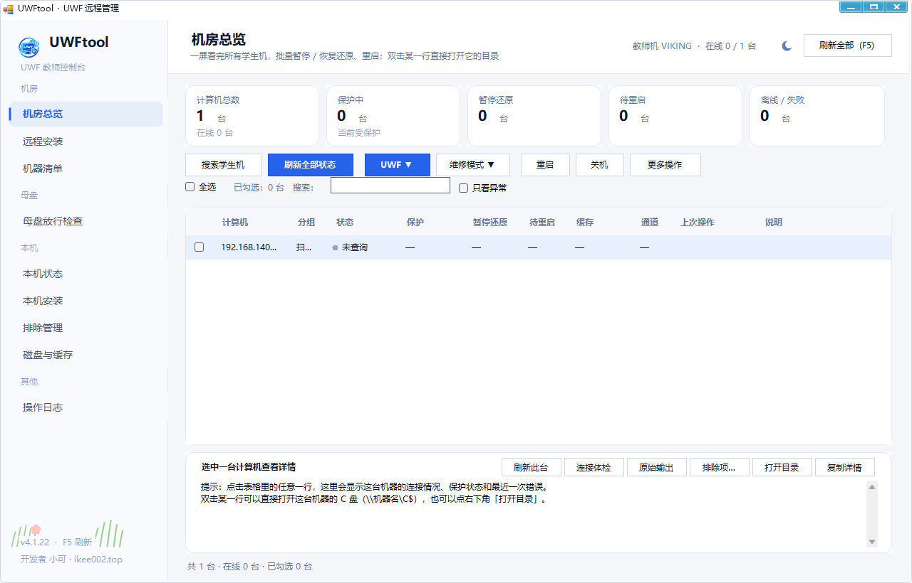
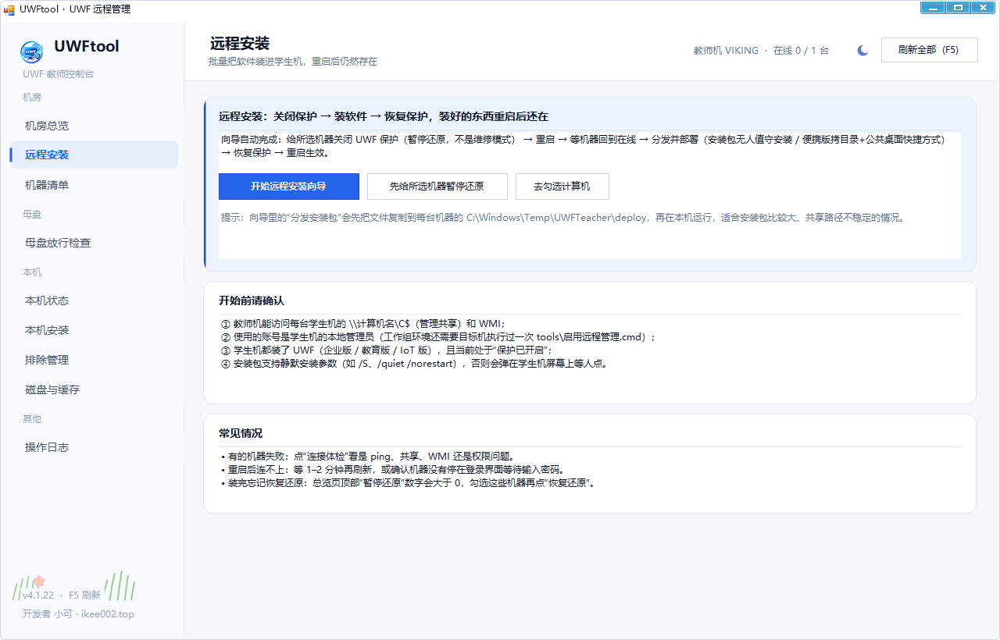
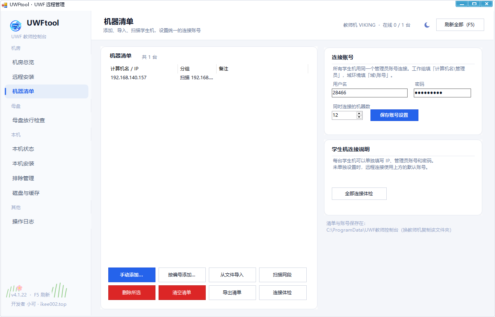
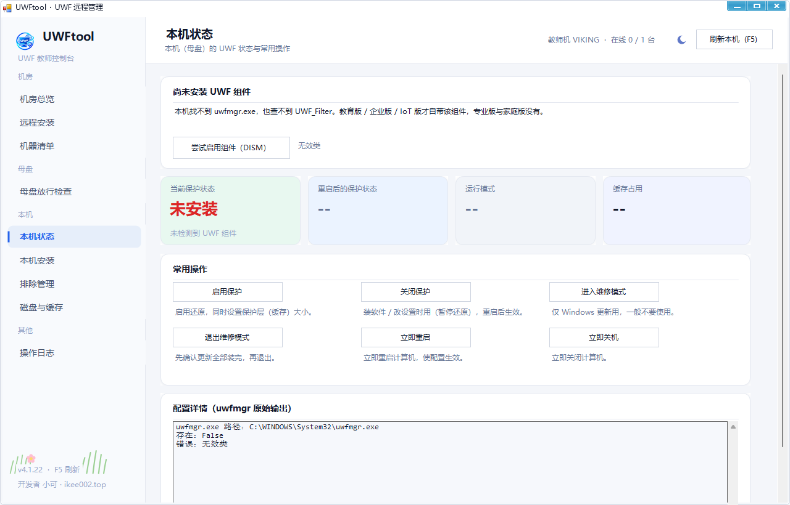
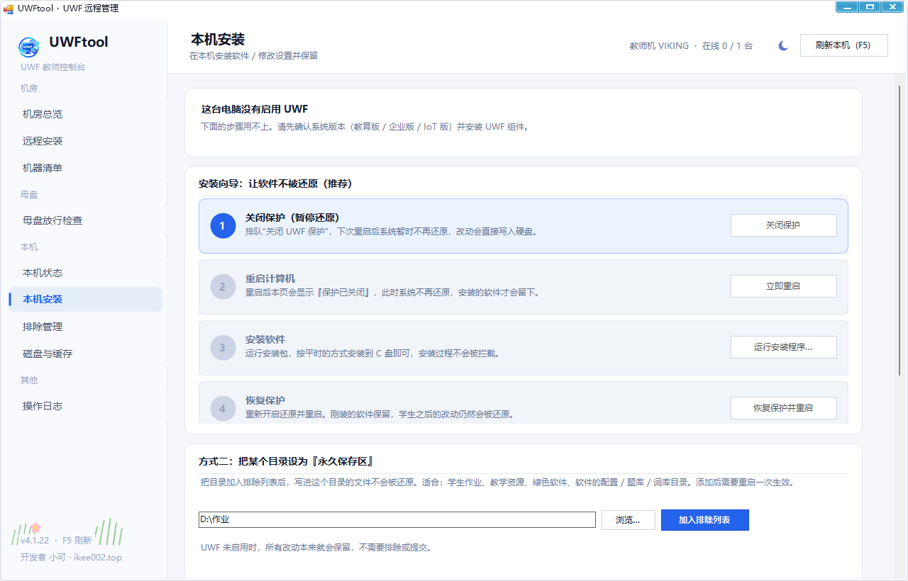
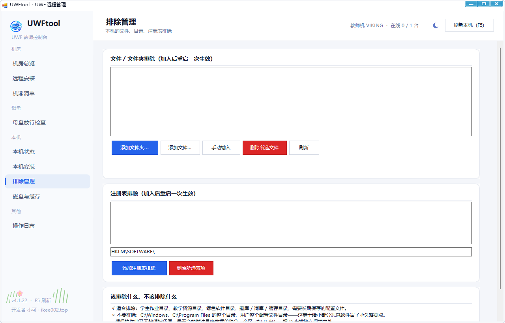
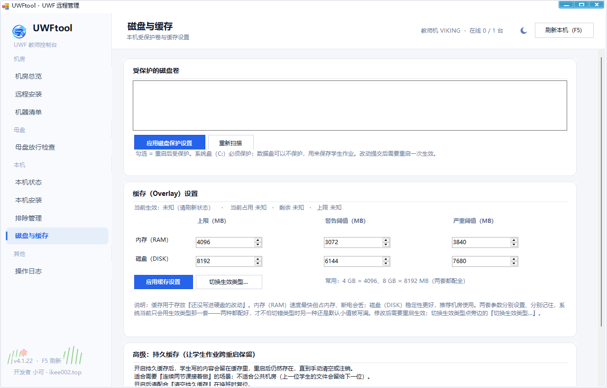

# UWFtool v4.1.22 发布说明

> **UWF 教师控制台 · 机房远程版** — 在教师机一个窗口里管理整个机房的 UWF 还原保护。

---

## 界面预览

### 机房总览
集中查看所有学生机状态，支持批量操作（暂停还原 / 恢复还原 / 重启 / 关机）。

### 远程安装
六步向导，远程给学生机装软件且重启后不被还原。

### 机器清单
学生机建档管理，支持搜索发现和批量添加。

### 母盘放行检查
一键检查母盘的 WMI / SMB / 端口 / UWF 组件配置。

### 本机状态
查看教师机自身的 UWF 保护状态、缓存用量、排除项。

### 本机安装
在教师机上安装 / 配置 UWF，含维修模式进入/退出。

### 排除管理
管理 UWF 文件/注册表排除项，设置不被还原的路径。

### 磁盘与缓存
设置 RAM / DISK 保护层缓存参数。

### 操作日志
完整的操作记录和诊断信息。

---

## 本版本更新内容

### AntdUI 集成
- 集成 **AntdUI 2.0.16**（Ant Design 风格 WinForms 控件库）
- 新增 `Ui.Notify()` 消息通知方法

### 界面美化升级
- **色彩系统**：采用 Ant Design 色彩算法 + Linear/Vercel 暗色设计 token
- **阴影效果**：Card / StatCard / RoundedPanel 添加多层柔和阴影
- **按钮样式**：Danger 改为实心红底白字，悬停/按压过渡更细腻
- **侧边栏**：加宽至 232px，品牌标题升级，导航按钮更大更精致
- **顶栏**：加高至 76px，标题更醒目
- **圆角体系**：Card 12px / Control 8px / Input 8px（Ant Design 风格）
- **字体系统**：新增 F11 / F14B / MonoB 字重层级
- **进度条**：改为圆角样式
- **步骤编号**：改为蓝底白字圆形徽标

### 可读性修复
- 修复亮色模式下部分文字黑底黑字不可见的问题
- 修复暗色模式下弱化文字对比度不足的问题
- 统一所有硬编码颜色为主题色变量
- 修复主题切换按钮背景穿透问题

### 数据一致性修复
- **修复总览统计与表格数据矛盾**：`FleetSummary.Of` 统一使用 `InMaintenance` 判断"暂停还原"，与表格逻辑保持一致

---

## 系统要求

- Windows 7 / 10 / 11（教育版 / 企业版 / IoT 版）
- .NET Framework 4.0+
- 管理员权限

## 安装使用

1. 解压 `UWFtool-v4.1.22.zip`
2. 运行 `UWFtool.exe`
3. 如 UAC 显示"未知发布者"，先运行 `信任发布者.cmd`

## 下载

| 文件 | 大小 | 说明 |
|------|------|------|
| `UWFtool-v4.1.22.zip` | ~2.9 MB | 完整发布包（含 AntdUI.dll + CSkin.dll） |

---

**开发者**：小可 · [www.ikee002.top](http://www.ikee002.top)
